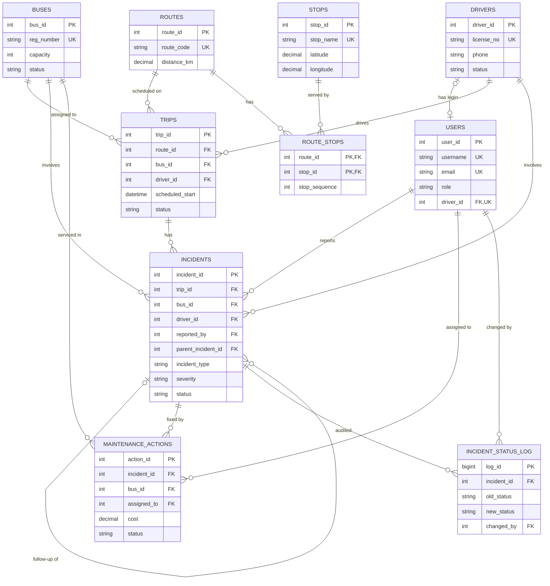

# ER Diagram

The [PNG export](ER_diagram.png) shows the foreign-key map. The editable Mermaid diagram below includes cardinalities and key attributes.

**Cardinalities.** Routes and stops are many-to-many through `ROUTE_STOPS`. A trip uses one route, one bus and one driver. An incident belongs to one trip and may follow up an earlier incident (self reference, used for recurring-issue chains). One incident can lead to several maintenance actions. Every status change is logged.

**NoSQL link.** MongoDB `incident_reports.incident_id` equals `INCIDENTS.incident_id`; `bus_telemetry.bus_id` equals `BUSES.bus_id`.
