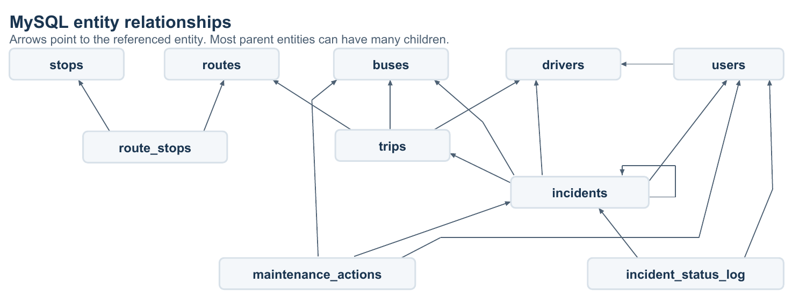
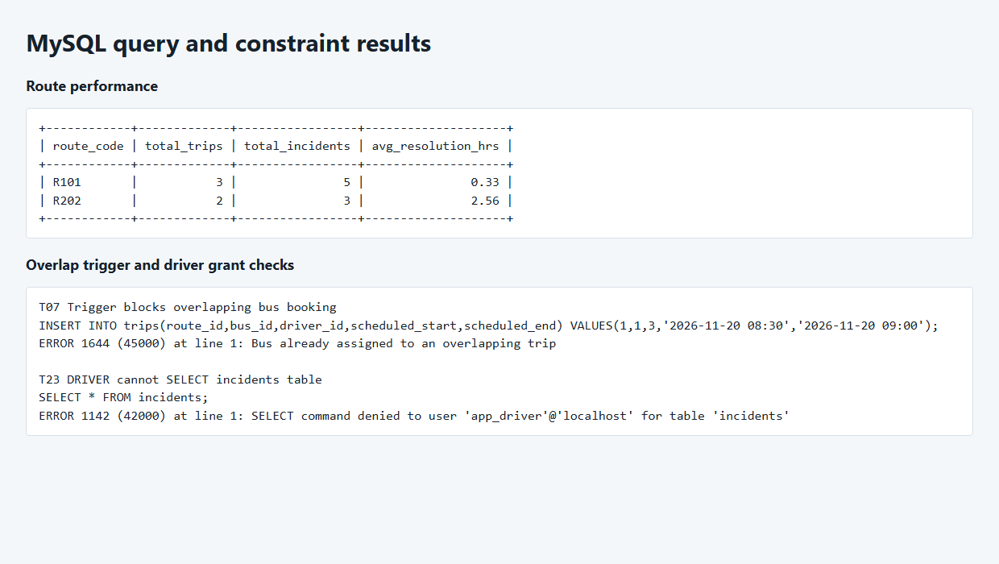
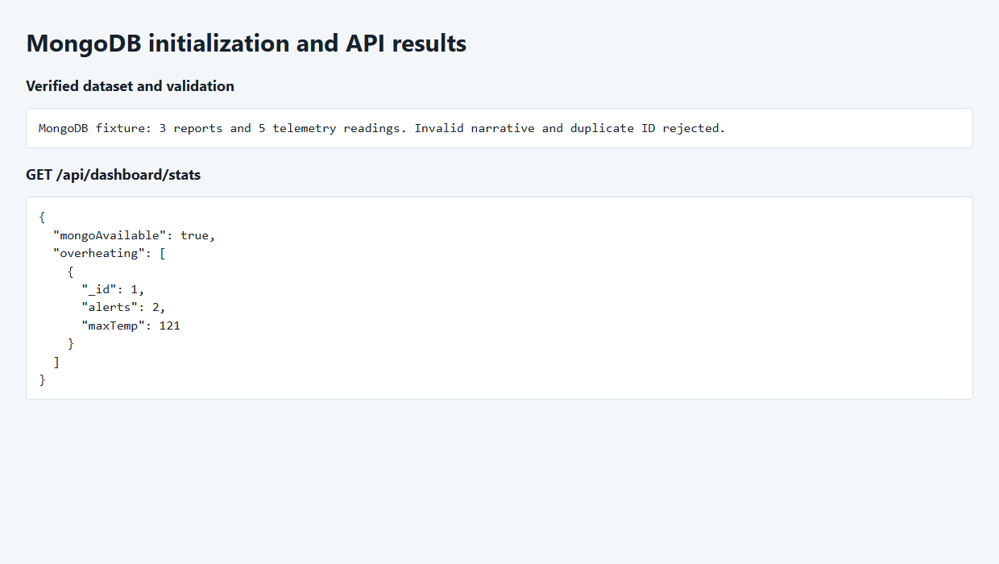
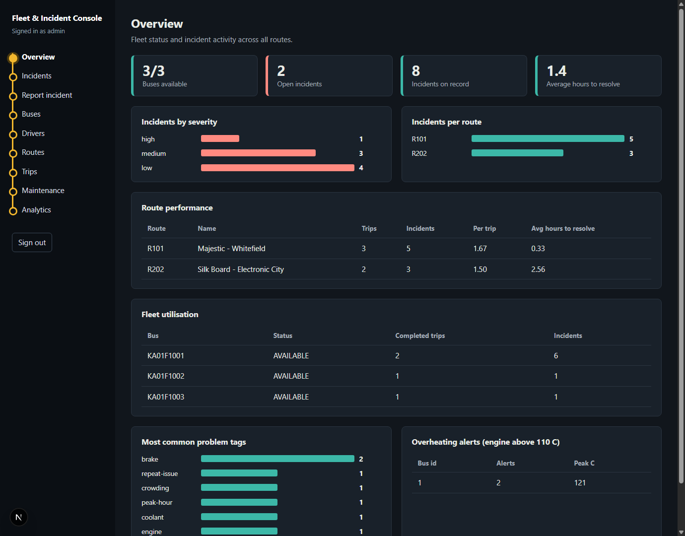
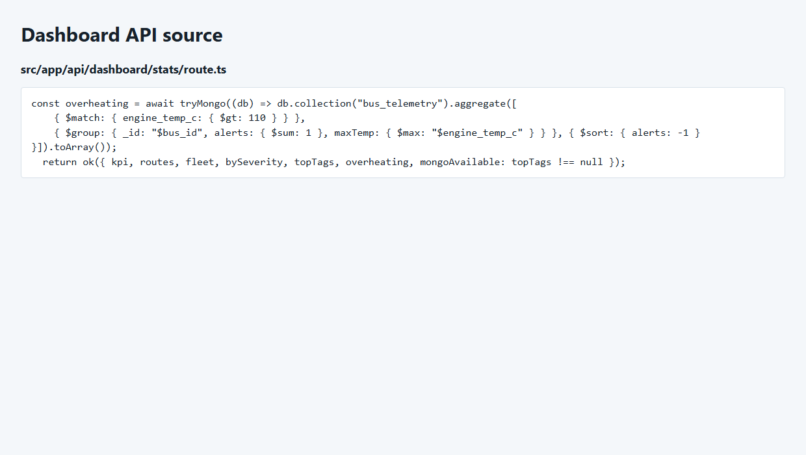
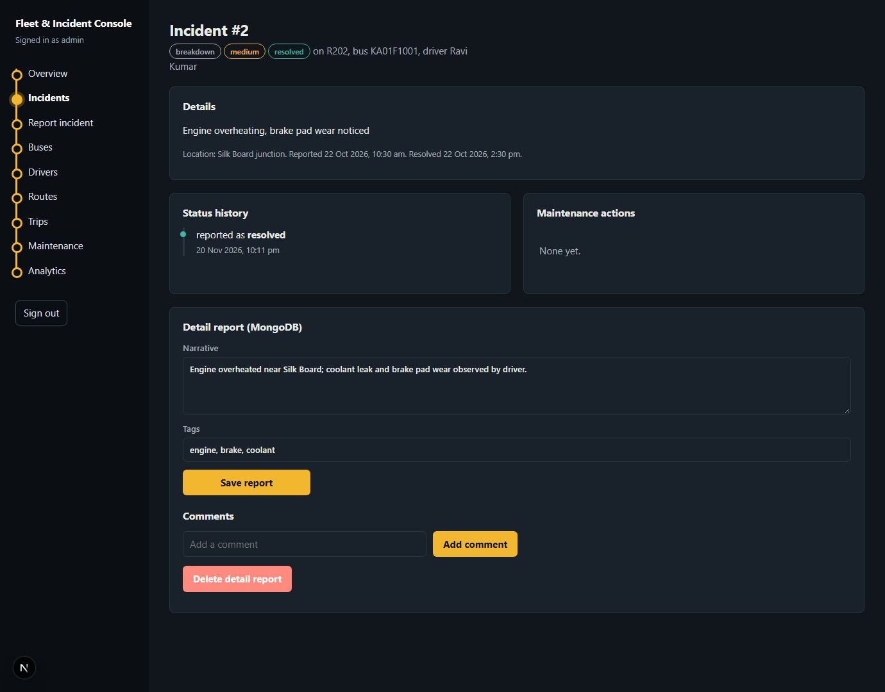
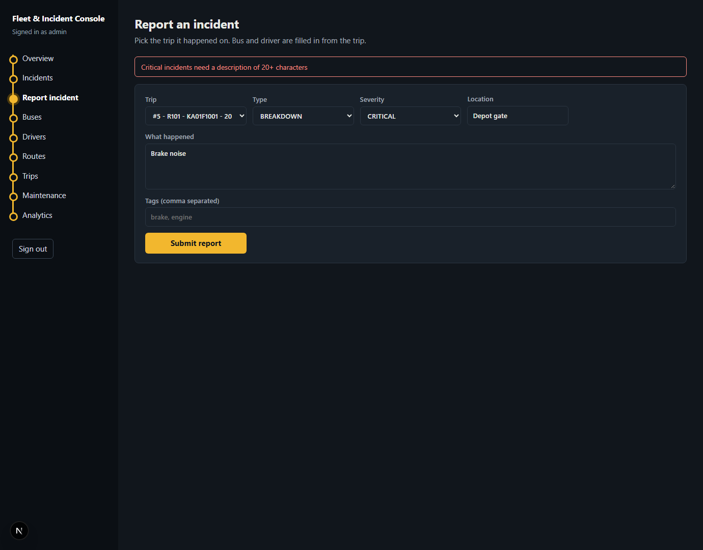

# TransitOps Public Transport Incident and Fleet Management System

PES University · DBMS Experiential Learning Level 3 · Aug–Dec 2026

Batchu Hari Nainika (PES1UG24AM461) and Rohini Vishu (PES1UG24AM922)

[Word report](PROJECT_REPORT.docx) · [PDF report](PROJECT_REPORT.pdf)

## Abstract

TransitOps helps public transport staff schedule buses and drivers and track disruptions from the first incident report through maintenance and resolution. It provides role-based trip and incident screens, fleet and route analytics, problem tags, and overheating alerts. MySQL enforces keys, scheduling rules, transactions and database grants. MongoDB stores incident narratives, comments, tags and telemetry. Next.js supplies the web interface and the route handlers that connect it to both databases.

## Introduction

### Problem Statement

Vehicle breakdowns, delays and conflicting assignments interrupt public transport service. Dispatch staff need a consistent record of the affected trip, vehicle, driver and actions taken.

### Objectives and Scope

TransitOps supports scheduling, incident reporting, maintenance and operational analytics. The objectives are to prevent overlapping assignments, preserve an incident timeline and show recurring incidents and telemetry patterns. A future version could add a dedicated live telemetry screen and an assignment planner for out-of-service buses.

The primary workflow follows an incident from its report to maintenance and resolution. Database constraints, triggers and transactions protect the relational history. MongoDB allows the detail report to hold optional locations, tags and nested comments.

## User Requirements Specification

### Functional Requirements

Administrators maintain fleet and driver records. Managers plan trips, review incidents, assign maintenance and monitor analytics. Drivers see their assigned trips and can report incidents on those trips. Staff can filter incidents, search descriptions and review the incident timeline.

### Technology Stack and Justification

| Technology | Role in the project |
|---|---|
| Next.js 16.4.6, React 19, TypeScript | App Router pages and route handlers in one project |
| Node.js 20.9+, npm, tsx | Application runtime, dependencies, seed scripts and API tests |
| MySQL 8, InnoDB, mysql2 | Relational schema, joins, constraints, transactions, procedures, triggers and database roles |
| MongoDB 6+, MongoDB Node.js driver, mongosh | Document validation, report CRUD, telemetry expiration and aggregation |
| Zod, bcryptjs, jose | Request validation, password hashing and signed session cookies |
| Git | Version tracking for the application, database scripts and documentation |

MySQL is used for the structured records that need foreign keys and transactional updates. MongoDB stores flexible incident documents and telemetry, where a text index, geospatial index and time-based expiration meet the application requirements.

## E-R Model

### Entities and Attributes

The entities are Driver, User, Bus, Route, Stop, Trip, Incident, Maintenance Action and Incident Status Log. Route Stop is an associative relation identified by its route and stop keys. The status log and maintenance action depend on the incident lifecycle and have their own primary keys.



Figure 1. Ten MySQL relations and their foreign-key relationships.

The Route–Stop relationship is many-to-many. A trip refers to one bus, one driver and one route. Incidents can reference optional parent incidents. Incident tags, witnesses and comments are multivalued or nested fields in MongoDB; the SQL tables use atomic attributes.

The detailed ER source includes cardinalities and key attributes. See [ER_diagram.md](ER_diagram.md).

## Relational Model

### Schema and Keys

| Table | Primary key | Foreign keys and rules |
|---|---|---|
| drivers | driver_id | Unique licence number, validated phone |
| users | user_id | Optional unique driver_id references drivers, required for driver accounts. Unique username and email |
| buses | bus_id | Unique registration number, capacity 10–120 |
| routes | route_id | Unique route code, positive distance |
| stops | stop_id | Unique stop name, bounded coordinates |
| route_stops | route_id, stop_id | References routes and stops. Stop sequence unique within a route |
| trips | trip_id | Required route, bus and driver. End follows start |
| incidents | incident_id | Required trip, bus, driver and reporter. Optional parent incident |
| maintenance_actions | action_id | Required incident, bus and assigned user. Nonnegative cost |
| incident_status_log | log_id | Required incident and user who changed the status |

Route Stops is the associative relation between Route and Stop. Staff records allow an optional Driver dependency. The full schema definitions and attribute-level constraints are in db/schema.sql and docs/data_dictionary.md.

Most parent deletions are restricted. Route-stop links and incident status logs cascade, and a deleted parent incident clears the follow-up reference. The incident table deliberately stores the trip's bus and driver for history queries. Its insert trigger checks that both match the trip.

## SQL DDL Statements

Install the MySQL objects in this order using the files under db/: schema, procedures, triggers, views, RBAC and seed. The schema script resets the named demo database, so it is intended for a disposable installation.

```sql
CREATE DATABASE transport_db CHARACTER SET utf8mb4
  COLLATE utf8mb4_unicode_ci;
USE transport_db;

CREATE TABLE route_stops (
  route_id      INT NOT NULL,
  stop_id       INT NOT NULL,
  stop_sequence SMALLINT UNSIGNED NOT NULL,
  PRIMARY KEY (route_id, stop_id),
  UNIQUE KEY uq_route_seq (route_id, stop_sequence),
  CONSTRAINT fk_rs_route FOREIGN KEY (route_id) REFERENCES routes(route_id) ON DELETE CASCADE,
  CONSTRAINT fk_rs_stop  FOREIGN KEY (stop_id)  REFERENCES stops(stop_id)
) ENGINE=InnoDB;

ALTER TABLE drivers ADD COLUMN joined_on DATE NULL;
ALTER TABLE drivers DROP COLUMN joined_on;
```

The schema defines primary, foreign, unique and check constraints. Secondary indexes support bus and trip history. A full-text index supports searching incident descriptions and locations. The route-performance view combines trips, incidents and average resolution time.

## SQL DML Statements

```sql
INSERT INTO route_stops VALUES (1,1,1),(1,2,2),(1,3,3),(2,4,1),(2,5,2);
UPDATE drivers SET experience_years = experience_years + 1
WHERE driver_id = 2;
DELETE FROM incident_status_log
WHERE changed_at < NOW() - INTERVAL 2 YEAR;
SELECT * FROM v_route_performance ORDER BY total_incidents DESC;
```

These project statements demonstrate insert, update, delete and select. The cleanup example is intended for the disposable demo. The incident register joins five tables. Grouping and HAVING identify repeated breakdowns. Nested and correlated queries find above-average routes and slower resolutions, and a recursive CTE follows parent incidents.

The incident report, maintenance assignment and resolution procedures use transactions, row locks and rollback. Triggers enforce scheduling and incident rules and log status changes. MySQL roles limit administrator, manager and driver operations.

## NoSQL Database Commands

MongoDB maintains the incident_reports and bus_telemetry collections. The first has a unique incident ID, text and geospatial indexes. The second is indexed by bus and time and expires readings after 90 days. Initialisation creates validators and indexes. Seeding a fresh demo inserts three reports and five readings.

```text
mongosh "mongodb://127.0.0.1:27017" db/mongo/init.js
mongosh "mongodb://127.0.0.1:27017" db/mongo/seed.js
```

The init script recreates transport_nosql. For a normal restart, reuse the data directory with scripts/start-mongodb.ps1.

```javascript
const nosql = db.getSiblingDB("transport_nosql");
// Create a temporary report in a disposable demo database.
nosql.incident_reports.insertOne({
  incident_id: 99, reported_by: 2, narrative: "Depot test report.",
  tags: ["depot"], comments: [], created_at: new Date()
});
nosql.incident_reports.findOne({ incident_id: 99 });
nosql.incident_reports.updateOne(
  { incident_id: 99 }, { $addToSet: { tags: "checked" } }
);
nosql.incident_reports.deleteOne({ incident_id: 99 });

nosql.bus_telemetry.aggregate([
  { $match: { engine_temp_c: { $gt: 110 } } },
  { $group: { _id: "$bus_id", alerts: { $sum: 1 },
              maxTemp: { $max: "$engine_temp_c" } } },
  { $sort: { alerts: -1 } }
]);
```

The temporary report illustrates create, read, update and delete. The pipeline filters readings over 110°C and returns the alert count and peak for each bus.

## Results



Figure 2. MySQL route performance and actual overlap and permission rejections.



Figure 3. MongoDB validation and the dashboard API response. Bus 1 recorded two alerts and a 121°C peak.

The fresh Windows verification passed all 30 SQL checks and all five API test groups, including the MongoDB create, read, edit, comment, role-restricted delete and aggregation flow. This run used Next.js 15.5.29. The repository pins 16.4.6 and the team's supplied production verification used that version. The screenshots came from disposable demo data.

## Next.js Project Tree Structure

```text
fleet-incident-system/
  db/
    mongo/
      init.js
      queries.js
      seed.js
    procedures.sql
    queries.sql
    rbac.sql
    schema.sql
    seed.sql
    setup.sh
    triggers.sql
    views.sql
  docs/
    screenshots/
      README.md
      analytics.png
      application-code.png
      dashboard-response.json
      dashboard.png
      driver-view.png
      incident-detail.png
      incidents-list.png
      login.png
      mongodb-results.png
      mysql-results.txt
      mysql-terminal.png
      report-incident-form.png
      report-incident.png
    ER_diagram.md
    ER_diagram.png
    PROJECT_REPORT.docx
    PROJECT_REPORT.md
    PROJECT_REPORT.pdf
    architecture.md
    data_dictionary.md
    relational_schema.md
    test_report.md
  scripts/
    seed-users.ts
    start-mongodb.ps1
  src/
    app/
      (dashboard)/
        analytics/
          page.tsx
        buses/
          page.tsx
        dashboard/
          page.tsx
        drivers/
          page.tsx
        incidents/
          [id]/
            page.tsx
          new/
            page.tsx
          page.tsx
        maintenance/
          page.tsx
        my-trips/
          page.tsx
        routes/
          page.tsx
        trips/
          page.tsx
        layout.tsx
      api/
        analytics/
          route.ts
        auth/
          login/
            route.ts
          logout/
            route.ts
          me/
            route.ts
        buses/
          [id]/
            route.ts
          route.ts
        dashboard/
          stats/
            route.ts
        drivers/
          route.ts
        incidents/
          [id]/
            assign/
              route.ts
            comments/
              route.ts
            report/
              route.ts
            resolve/
              route.ts
            route.ts
          search/
            route.ts
          route.ts
        maintenance/
          route.ts
        my/
          route.ts
        routes/
          route.ts
        telemetry/
          route.ts
        trips/
          route.ts
      login/
        page.tsx
      globals.css
      layout.tsx
      page.tsx
    components/
      RoleProvider.tsx
      Sidebar.tsx
      ui.tsx
    lib/
      auth/
        rbac.ts
        session.ts
      db/
        mongo.ts
        mysql.ts
      api.ts
      validators.ts
    types/
      index.ts
    middleware.ts
  tests/
    api.test.ts
    run_sql_tests.sh
  .env.example
  .gitignore
  LICENSE
  README.md
  next-env.d.ts
  next.config.mjs
  package-lock.json
  package.json
  tsconfig.json
```

The App Router serves the dashboard screens and API handlers. src/lib/db contains the MySQL role pools and the MongoDB connection. src/lib/auth and middleware enforce session and role rules. The root configuration uses package.json, package-lock.json, next.config.mjs and tsconfig.json.

## Sample Screenshots



Figure 4. Administrator dashboard with fleet metrics, problem tags and telemetry alerts.



Figure 5. Dashboard API source for MongoDB aggregation.

## Sample Screenshots Continued



Figure 6. Incident detail with SQL status history and editable MongoDB fields.



Figure 7. Database validation rejects a CRITICAL report with a short description.

The remaining login, incident search, driver, form and analytics views are in [the screenshot index](screenshots/README.md).

## Evaluation Rubrics

| # | Evaluation component | Correct / partial / absent | Completion status | Project evidence |
|---|---|---|---|---|
| 1 | ER diagram | 2 / 1 / 0 | Completed | ER relationship map and Mermaid source |
| 2 | Relational schema, keys, relationships and constraints | 3 / 2 / 0 | Completed | Ten-table schema, foreign keys and constraint tests |
| 3 | SQL DDL with constraints | 4 / 3 / 0 | Completed | schema.sql, indexes and DDL tests |
| 4 | NoSQL or vector database creation | 4 / 3 / 0 | Completed | MongoDB collections, validators, indexes and seed files |
| 5 | Technology justification | 1 / 0 / 0 | Completed | MySQL and MongoDB responsibilities in section 4 |
| 6 | DML operations | 4 / 3 / 0 | Completed | seed.sql, queries.sql and incident write procedures |
| 7 | Nested, correlated, recursive and join queries | 4 / 3 / 0 | Completed | queries.sql Q1, Q3, Q4 and Q5 |
| 8 | Procedures, functions, triggers and CTEs | 6 / 3 / 0 | Completed | Routines, triggers, rollback tests and analytics |
| 9 | NoSQL feature and read, update and delete | 7 / 4 / 0 | Completed | Report API, comments, telemetry and roles in API tests |
| 10 | Next.js interface | 3 / 2 / 0 | Completed | Fleet dashboard, incident detail and role-specific pages |
| 11 | Backend, API and database integration | 2 / 1 / 0 | Completed | Route handlers and dashboard queries spanning both databases |
| 12 | Authentication, two or more roles and database RBAC | 4 / 3 / 0 | Completed | Login and three MySQL-backed roles |
| 13 | Documentation and Git/GitHub | 2 / 1 / 0 | Partially Completed | Two existing GitHub commits verified. Submission changes await a team push |
| 14 | Originality, individual contribution and modification/viva | 4 / 2 / 0 | Partially Completed | Fleet-specific incident and telemetry workflow documented. Individual contributions and viva await confirmation |

The 14 items have a combined maximum of 50 marks. Statuses report implementation and evidence. The academic evaluator determines marks.

### GitHub and Individual Contributions

Repository baseline fc456606 on main. Its public history shows an initial import under PES1UG24AM922 and a deliverables update under RohiniVishu.

Batchu Hari Nainika and Rohini Vishu are the confirmed team members. Their individual feature assignments await team confirmation.

[Project repository on GitHub](https://github.com/PES1UG24AM922/DBMS-MiniProject-FleetIncidentSystem)
