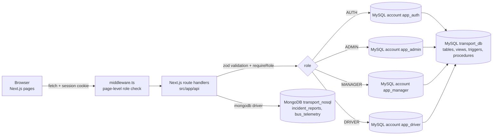

# System Architecture

## Layers

| Layer | Technology | Responsibility |
|---|---|---|
| Presentation | Next.js App Router, React | Forms, tables, filters, dashboards; menu items depend on the signed-in role |
| API | Route handlers in `src/app/api` | Input validation (zod), role guard, calls to MySQL and MongoDB, clean error responses |
| Authentication | bcrypt, JWT in an HttpOnly cookie (jose) | Login, 8-hour session, logout |
| Relational data | MySQL 8 | Core records, integrity (constraints, triggers), transactions (procedures), reporting (views, CTEs) |
| Document data | MongoDB | Free-form incident narratives, comments, tags, geo points and high-volume telemetry |

## Defence in depth for access control

1. **Page level:** `src/middleware.ts` redirects users away from pages their role may not open.
2. **API level:** each handler calls `requireRole([...])` and answers 401 or 403.
3. **Database level:** every application role connects with its own MySQL account holding a MySQL role (`role_admin`, `role_manager`, `role_driver`). Even if API code were wrong, the database refuses the statement. Drivers have no table access to incidents or trips; they use the procedures `sp_report_incident`, `sp_driver_trips` and `sp_driver_incidents`, which run with definer rights and filter by the driver's own id. The login account `app_auth` can read only the six columns needed to sign in.

## Why two databases

| Data | Store | Reason |
|---|---|---|
| Buses, drivers, routes, trips, incidents, maintenance, users | MySQL | Highly related, needs foreign keys, constraints and ACID transactions, and the dashboards need joins and aggregates |
| Incident narratives, witnesses, comments, tags, locations | MongoDB | Structure varies by incident type and grows over time; document model and text, tag and geo indexes fit better than extra tables |
| Bus telemetry | MongoDB | Append-only, time-stamped, high volume, no joins; a TTL index removes old readings automatically |

MySQL is the source of truth. If MongoDB is unreachable, incident creation still succeeds (the response reports `mongoDetailSaved: false`) and the pages show a notice instead of failing.

## Key request flow: reporting an incident

1. The form posts to `POST /api/incidents`.
2. The handler validates the body and checks the role.
3. It opens a connection with that role's MySQL account and calls `sp_report_incident` (transaction).
4. Triggers check bus and driver against the trip, write the status log and, for serious breakdowns, set the bus to MAINTENANCE.
5. The handler stores the narrative, tags and location in MongoDB.
